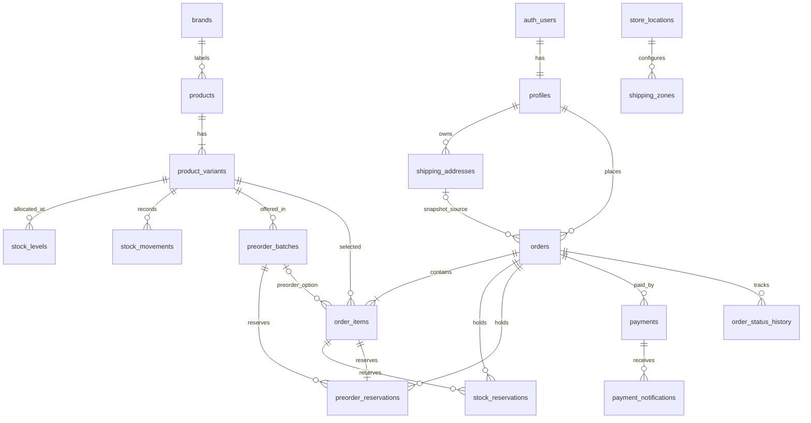

# Red Sneakers HQ

<p align="center">
  <strong>Toko online, operasi inventaris, pre-order, dan POS toko dalam satu sistem yang transaksional dan aman.</strong>
</p>

<p align="center">
  <a href="https://nextjs.org"></a>
  <a href="https://www.typescriptlang.org"></a>
  <a href="https://supabase.com"></a>
  <a href="https://midtrans.com"></a>
</p>

**Red Sneakers HQ** adalah aplikasi e-commerce B2C sepatu konsumen berkualitas portofolio yang dirancang untuk mengatasi masalah umum ritail: keterputusan inventaris antara toko fisik dan toko online. Aplikasi menyediakan model inventaris bersama dan dapat diperiksa untuk pemesanan online, penjualan toko fisik, pengambilan barang di toko, dan pre-order.

> Status proyek: Fases 1–7 telah diimplementasi. Pemeriksaan otomatis lokal lulus; verifikasi basis data menyeluruh memerlukan Docker Desktop dan instance Supabase yang berjalan.

## 1. Gambaran Umum Produk

| Area | Fungsi |
|------|--------|
| Toko online | Katalog sepatu dapat dicari, varian produk, ketersediaan stok langsung, dan akun pelanggan |
| Checkout | Pengiriman atau pengambilan di toko; harga dan biaya pengiriman dihitung di server; peta koordinasi pengiriman |
| Inventaris | Alokasi stok `STORE` / `ONLINE`, reservasi kunci baris secara atomik, dan buku besar pergerakan stok yang hanya ditambahkan |
| Pembayaran | Transaksi Midtrans Snap dibuat di server, verifikasi tanda tangan SHA-512 notifikasi, dan webhook idempotensi |
| Pre-order | Batch yang dikontrol kuota, pembayaran penuh atau uang muka, penagihan saldo, dan penerimaan inventaris |
| Operasi toko | Kasir POS, pemenuhan pesanan, konfirmasi pengambilan, dan pembaruan stok secara realtime |
| Admin | Manajemen produk dan inventaris, tampilan stok rendah, ringkasan penjualan, dan ekspor CSV terbatas |

## 2. Unggulan Teknis

- Prosedur basis data PostgreSQL melakukan perhitungan harga, reservasi/konfirmasi stok, penjualan POS, dan perubahan kuota pre-order secara transaksional.
- Kunci baris dan batasan basis data melindungi inventaris dari penjualan berlebihan selama permintaan bersamaan.
- Setiap penyesuaian, reservasi, rilis, dan penjualan stok dicatat dalam `stock_movements`.
- Keamanan Tingkat Baris (RLS) Supabase dan pemeriksaan peran di sisi server memisahkan akses pelanggan, kasir, dan admin.
- Validasi Zod berjalan di batas server; kunci peran layanan Supabase dan kunci server Midtrans tetap hanya di sisi server.
- Uji unit mencakup tanda tangan/status pembayaran, penanganan webhook, validasi POS, validasi pre-order, dan pelarasan rumus CSV.

## 3. Teknologi yang Digunakan

**Next.js App Router · TypeScript strict · React · Tailwind CSS · Supabase/PostgreSQL · Supabase Auth dan Realtime · Midtrans Snap · Leaflet/OpenStreetMap · Zod · React Hook Form · Vitest**

## 4. Persyaratan Sistem dan Perangkat Lunak

- Node.js 20.9+
- npm (mengikuti `package-lock.json`)
- Docker Desktop (untuk menjalankan Supabase secara lokal)
- Supabase CLI (terpasang sebagai dependensi proyek)

## 5. Langkah Instalasi dan Konfigurasi

1. Salin berkas contoh variabel lingkungan:

```powershell
Copy-Item .env.example .env.local
```

2. Pasang dependensi:

```powershell
npm install
```

3. Jalankan Supabase lokal dan terapkan migrasi:

```powershell
npm run db:start
npm run db:reset
```

4. Buat akun demo:

```powershell
npm run seed:users
```

5. Jalankan aplikasi dalam mode pengembangan:

```powershell
npm run dev
```

Sebelum memulai aplikasi, isi kunci Supabase dan sandi akun demo unik di `.env.local`. Konfigurasikan kunci Midtrans sandbox untuk menguji pembayaran. Jangan pernah melakukan komit `.env.local`; berkas dikecualikan oleh `.gitignore`.

Untuk setup Supabase hosted, konfigurasi notifikasi pembayaran, diagram ER, detail migrasi, dan skenario uji berorientasi tesis, lihat bagian-bagian di bawah ini.

---

Aplikasi B2C sneakers berbasis Next.js dan Supabase. Fase 1 menyediakan fondasi data, ledger stok, RLS, dan seed; Fase 2 menambahkan autentikasi, katalog yang membaca saldo langsung dari Supabase, serta konsol admin untuk mengelola produk, varian, gambar, dan penyesuaian stok; Fase 3 menambahkan keranjang, checkout dengan reservasi stok dan peta alamat; Fase 4 menambahkan pembayaran Midtrans Snap beserta webhook idempoten, halaman lacak pesanan, dan riwayat status; Fase 5 menyediakan batch pre-order dan pembayaran DP/pelunasan; Fase 6 menambahkan POS staf, pemenuhan order, stok realtime, dan laporan admin.

## Keputusan desain

- Stok dipisah per varian dan alokasi `STORE` / `ONLINE`. Kasir mengurangi alokasi toko fisik, checkout online mengurangi alokasi online, dan pengambilan di toko mereservasi alokasi `STORE`. Ini mencegah unit yang sama dijual dua kanal sebelum ada proses transfer alokasi yang tercatat.
- `stock_levels` adalah proyeksi saldo terkini, sedangkan `stock_movements` adalah ledger append-only. Perubahan stok dari klien diblokir RLS; backend hanya menggunakan RPC transaksional untuk penyesuaian, reservasi, pelepasan, dan konfirmasi.
- Reservasi mengurangi ketersediaan dengan menaikkan `reserved_qty`, bukan langsung menurunkan `on_hand`. Fungsi SQL mengunci baris stok dengan `FOR UPDATE`; constraint menjaga `reserved_qty <= on_hand`.
- Kuota pre-order memiliki reservasi terpisah dan dikunci pada baris batch, sehingga pemesanan bersamaan tidak dapat melewati kuota.
- Role berada di `profiles`, dibuat sebagai `customer` oleh trigger Auth. Role `admin` atau `cashier` hanya boleh ditetapkan oleh admin melalui backend tepercaya.
- Harga, ongkir, waktu kedaluwarsa, dan total order harus dihitung ulang di server. Kunci service role dan Midtrans hanya dipakai di server, tidak pernah dikirim ke browser.
- Pengguna baru mendapat role `customer` dari trigger Auth. Akses admin diperiksa di server untuk setiap action; RPC `adjust_stock` hanya dapat dipanggil server dengan service role setelah guard admin berhasil.
- Katalog mengambil produk aktif melalui server Supabase client; perubahan saldo yang diizinkan RLS dipancarkan ke tampilan melalui Supabase Realtime. Tidak ada jalur browser yang dapat menulis langsung ke saldo stok.
- POS mencatat order offline, pembayaran, saldo, dan `sale_offline` ledger movement melalui satu RPC bertanda `request_id` idempoten. Saldo/harga ditentukan database setelah row lock, bukan dari harga atau ketersediaan yang ditampilkan di kasir.
- Alur staf menahan order preorder sampai setiap item memiliki status `ready`; pemeriksaan diulang dalam RPC pemenuhan supaya request langsung tidak dapat melewati penerimaan barang atau pelunasan.
- Ringkasan dan ekspor laporan hanya tersedia untuk admin; ekspor dibatasi ke 7/30/90 hari dan 10.000 pembayaran settlement, dengan escape CSV untuk mencegah formula spreadsheet.

## ERD



Satu lokasi toko dapat memiliki banyak zona ongkir. Constraint exclusion mencegah rentang jarak zona untuk lokasi yang sama saling tumpang tindih.

## Menjalankan lokal

Prasyarat: Node.js 20.9 atau lebih baru, Docker Desktop aktif, dan akun Supabase untuk deployment hosted.

1. Salin `.env.example` menjadi `.env.local`. Isi URL, anon key, dan `NEXT_PUBLIC_SITE_URL` (lokal: `http://localhost:3000`) dari Supabase. Kunci service role hanya dipakai server dan skrip lokal; jangan pernah gunakan prefix `NEXT_PUBLIC_`.
2. Jalankan `npm install`.
3. Jalankan `npm run db:start` untuk Supabase lokal, lalu `npm run db:reset` untuk menerapkan migration dan seed. Migration membuat bucket publik `product-images` dengan batas 5 MB dan MIME type gambar yang diizinkan.
4. Jalankan `npm run db:types` untuk menghasilkan tipe TypeScript dari schema lokal setelah Docker/Supabase lokal aktif.
5. Isi variabel `DEMO_*` di `.env.local` dengan alamat email dan password lokal yang unik, minimal 12 karakter. Jalankan `npm run seed:users` untuk membuat akun demo dan menetapkan role admin, kasir, dan customer.
6. Pada Supabase Auth, atur Site URL dan Redirect URLs, termasuk `http://localhost:3000/auth/callback`. Untuk hosted deployment, masukkan URL domain Vercel yang sama ke `NEXT_PUBLIC_SITE_URL` dan daftar redirect Supabase.
7. Jalankan `npm run dev`, lalu buka `http://localhost:3000`.

Seed katalog berisi satu produk contoh berlabel demo. Seed sengaja tidak mengisi koordinat toko atau tarif pengiriman nyata; admin perlu memasukkan alamat toko dan zona ongkir yang benar sebelum mengaktifkan pengiriman.

## Supabase hosted

1. Buat project Supabase, lalu jalankan `npx supabase login` dan `npx supabase link --project-ref <project-ref>`.
2. Terapkan database dengan `npx supabase db push`. Seed data demo lokal tidak otomatis diterapkan ke hosted; gunakan hanya data yang memang disetujui untuk environment tersebut.
3. Bucket `product-images` dan policy admin untuk unggah/hapus gambar dibuat oleh migration.
4. Atur Site URL dan Redirect URLs di Authentication > URL Configuration, termasuk `<APP_URL>/auth/callback`.
5. Tambahkan environment variable dari `.env.example` di Vercel. `SUPABASE_SERVICE_ROLE_KEY` dan `MIDTRANS_SERVER_KEY` tetap server-only dan tidak diperlukan untuk render katalog. Jangan menaruhnya pada variabel publik.
6. Tetapkan role admin dengan prosedur server tepercaya atau skrip akun demo. Jangan izinkan pelanggan mengubah `profiles.role` sendiri.
7. `NEXT_PUBLIC_*` dibundel saat proses build Next.js. Setelah mengubahnya, jalankan build ulang atau deploy ulang agar UI menggunakan nilai terbaru.

## Fase 2: autentikasi, katalog, dan inventaris

- `/login` dan `/signup` memakai Supabase Auth email/password, Zod, React Hook Form, dan callback verifikasi email `/auth/callback`.
- `/` menampilkan produk aktif, pencarian berdasarkan nama, filter merek, harga mulai, dan jumlah stok dari alokasi toko serta online.
- `/products/[slug]` menampilkan varian ukuran/warna, SKU, harga, stok tiap lokasi, dan pembaruan stok Realtime.
- `/admin/products` hanya tersedia bagi role `admin`. Admin dapat membuat merek/produk, menyembunyikan atau menampilkan produk, menambah varian, mengunggah foto ke bucket `product-images`, dan menyesuaikan saldo per lokasi.
- Pengurangan/penambahan saldo admin memakai RPC `adjust_stock`; perubahan tidak dilakukan melalui update browser ke `stock_levels`. RPC mengunci saldo dan mencatat ledger.
- Bila kredensial Supabase belum diisi, halaman menampilkan instruksi konfigurasi, bukan data katalog palsu. Uji Auth, storage, RLS, dan Realtime memerlukan project Supabase berjalan.

## Fase 3: keranjang, checkout, reservasi, dan peta

- `/checkout` hanya menerima akun customer. Form mengirim ID varian dan jumlah; harga serta total selalu diambil dan dihitung ulang oleh RPC `create_checkout_order`.
- Checkout pengiriman memerlukan pin koordinat. RPC `get_shipping_quote` menghitung Haversine dan ongkir dari zona aktif; penempatan pin di peta hanya meminta pratinjau, sedangkan RPC pembuatan order menghitung ulang ongkir dalam transaksi.
- Checkout ambil di toko mengurangi ketersediaan alokasi `STORE`; pengiriman memakai `ONLINE`. Keduanya memakai row lock `FOR UPDATE` dan menulis ledger `stock_movements` melalui fungsi reservasi yang telah ada.
- Reservasi berlaku 15 menit. Migration `202610130003_checkout_expiry.sql` menjadwalkan `release_expired_checkout_reservations()` tiap menit melalui `pg_cron`; proses melepas stok dan kuota pre-order, lalu menandai order kedaluwarsa sebagai `cancelled`.
- Pembayaran Midtrans belum diaktifkan pada fase ini. Order yang berhasil dibuat akan menampilkan total server dan waktu berakhirnya reservasi; integrasi Snap dan webhook menyusul pada Fase 4. (Sudah aktif sejak Fase 4; lihat bagian "Integrasi pembayaran".)

Langkah konfigurasi checkout:

1. Terapkan semua migration (`npm run db:reset` untuk lokal, atau `npx supabase db push` untuk hosted). Periksa `cron.job` di Supabase setelah migration untuk memastikan job `release-expired-checkout-reservations` aktif.
2. Isi koordinat lokasi fisik yang sebenarnya dan buat zona ongkir di `store_locations` / `shipping_zones` melalui Supabase SQL Editor. Aktifkan toko dan zona setelah rentang jarak serta tarif diverifikasi. Seed tidak membuat koordinat atau tarif fiktif.
3. Pastikan `.env.local` memiliki URL Supabase, anon key, dan `SUPABASE_SERVICE_ROLE_KEY` server-only. Jangan menaruh service role key dalam kode klien atau variabel `NEXT_PUBLIC_*`.
4. Masuk dengan akun ber-role `customer`, tambahkan varian ke keranjang, lalu uji pilihan pin pengiriman dan ambil di toko. Cek `orders`, `stock_reservations`, `stock_levels.reserved_qty`, dan `stock_movements` di database.
5. Untuk uji kedaluwarsa, buat reservasi yang waktunya telah lewat pada lingkungan uji, jalankan `select public.release_expired_checkout_reservations();`, lalu pastikan saldo reservasi kembali dan order berstatus `cancelled`.

## Struktur inti

```text
src/app/                         Halaman App Router dan server actions
src/app/api/                     Route handler (webhook pembayaran Midtrans)
src/app/orders/                  Daftar pesanan, detail pesanan, dan aksi pembayaran
src/components/                  UI toko online, checkout/peta, form auth, dan konsol admin
src/components/payment/          Tombol pembayaran Snap yang memuat snap.js
src/lib/catalog/                 Query katalog sisi server
src/lib/midtrans/                Konfigurasi, Snap, dan tanda tangan Midtrans
src/lib/orders/                  Query dan label pesanan
src/lib/payments/                Aplikasi notifikasi dan pembuatan token pembayaran
src/lib/reports/                 Ekspor CSV dan pelarasan sel
src/lib/stock/                   Hook stok realtime
src/lib/supabase/                Klien server, browser, service role, viewer, dan env
src/lib/validators/              Skema Zod untuk auth, checkout, katalog, midtrans, POS, pre-order
src/test/                        Stub pengujian sisi server
scripts/                         Skrip seed pengguna dan uji konkurensi stok
supabase/                        Migrasi, benih data, dan konfigurasi Supabase CLI
public/                          Aset statis
```
supabase/seed.sql                Brand, produk, stok demo, dan batch pre-order demo
vitest.config.ts                 Konfigurasi unit test beserta alias path dan stub server-only
.env.example                    Nama variabel environment tanpa secret
```

## Skenario pengujian BAB IV

| ID | Skenario | Input | Hasil yang diharapkan |
|---|---|---|---|
| DB-01 | Profile baru otomatis menjadi customer | User baru dibuat lewat Supabase Auth | Satu baris `profiles` dengan role `customer` |
| DB-02 | Pelanggan tidak dapat membaca order pelanggan lain | JWT customer A membaca order customer B | Tidak ada baris yang dikembalikan oleh RLS |
| DB-03 | Peran pelanggan tidak dapat menaikkan role sendiri | Permintaan update profil customer ke `admin` | Ditolak RLS |
| AU-01 | Akun baru dibuat dengan aman | Daftar memakai nama, email valid, dan password >= 10 karakter | Profil role customer dibuat; verifikasi email diarahkan ke callback |
| AU-02 | Login salah | Email dan password tidak cocok | Login ditolak tanpa membocorkan apakah email terdaftar |
| CAT-01 | Katalog filter dan pencarian | Nama model dan merek valid | Hanya produk aktif yang cocok ditampilkan |
| CAT-02 | Detail varian dan stok realtime | Buka produk aktif lalu ubah saldo via RPC admin | Ketersediaan STORE/ONLINE berubah setelah event Realtime |
| ADM-01 | Akses konsol admin | Customer membuka `/admin/products` | Akses ditolak; hanya role admin dapat masuk |
| ADM-02 | Penyesuaian stok tercatat | Delta non-zero dengan alasan dan lokasi | `stock_levels` berubah atomik dan ledger mencatat movement |
| ADM-03 | Pengurangan melewati stok tersedia | Admin memasukkan delta yang melanggar constraint/reservasi | RPC gagal; perubahan saldo tidak diterapkan |
| ADM-04 | Unggah gambar varian | Gambar JPEG/PNG/WebP/AVIF <= 5 MB | Berkas masuk bucket publik dan variant menyimpan image path |
| ST-01 | Reservasi stok tersedia | Satu order valid, stok tersedia | `reserved_qty` naik; ledger berisi `reservation` |
| ST-02 | Reservasi melebihi stok | Kuantitas melebihi `available_qty` | RPC gagal atomik; saldo dan ledger tidak berubah |
| ST-03 | Dua checkout berebut unit terakhir | Dua RPC reservasi berjalan serentak untuk unit yang sama | Satu berhasil, satu gagal; saldo tidak negatif |
| ST-04 | Pelepasan reservasi kedaluwarsa | Order dengan reservasi aktif | `reserved_qty` turun dan ledger berisi `release` |
| ST-05 | Konfirmasi pembayaran | Order berstatus `paid` dengan reservasi aktif | `on_hand` dan `reserved_qty` turun bersama; ledger `sale_online` |
| ST-06 | Web tidak mengubah stok langsung | Permintaan update `stock_levels` memakai anon/authenticated key | Ditolak RLS |
| CT-01 | Checkout tanpa sesi customer | Buka `/checkout` tanpa login | Dialihkan ke halaman login dengan tujuan kembali ke checkout |
| CT-02 | Total tidak mempercayai browser | Kirim `variantId` dan jumlah dengan harga buatan di payload | RPC membaca harga varian dari database dan mengabaikan harga kiriman |
| CT-03 | Pengiriman di luar zona | Pilih titik peta yang tidak tercakup zona aktif | Checkout menolak alamat dan tidak membuat order/reservasi |
| CT-04 | Reservasi checkout | Buat checkout shipping atau pickup dengan stok cukup | Order `pending_payment`, harga server, dan reservasi 15 menit tercatat |
| CT-05 | Stok habis saat checkout | Varian kehilangan stok sebelum submit | RPC menolak order; saldo dan ledger tidak berubah |
| CT-06 | Pelepasan otomatis reservasi | Jalankan job `pg_cron` setelah `reservation_expires_at` | Stok/kuota kembali, ledger `release` ditulis, dan order jadi `cancelled` |
| PO-01 | Kuota pre-order tersedia | Batch terbuka dengan kuota cukup | Reservasi kuota berhasil secara atomik |
| PO-02 | Kuota pre-order habis | Permintaan melewati sisa kuota | RPC gagal dan kuota tidak berubah |
| SEED-01 | Seed akun demo | Tiga set `DEMO_*` lokal valid | Auth users dan profil admin, kasir, customer tersedia |
| MT-01 | Pembuatan transaksi Snap | Order `pending_payment`, stok tercukupi | RPC `create_order_payment` mengembalikan baris pembayaran; token Snap diterima dari Midtrans |
| MT-02 | Nominal tidak dari klien | Payload checkout memuat harga palsu | `gross_amount` diambil dari `orders.total`; item Snap dibangun dari snapshot order |
| MT-03 | Pembayaran lunas (settlement) | Webhook berstatus `settlement` dengan signature valid | Order jadi `paid`; `confirm_stock_reservation` menurunkan `on_hand` dan `reserved_qty`; ledger `sale_online` |
| MT-04 | Kartu ditangkap (capture) | Webhook `capture` dengan `fraud_status: accept` | Dipetakan `settlement`, order jadi `paid` |
| MT-05 | Kartu dipertanyakan (capture challenge) | Webhook `capture` dengan `fraud_status: challenge` | Dipetakan `pending`; order tetap `pending_payment` dan reservasi tetap aktif |
| MT-06 | Pembayaran kedaluwarsa (expire) | Webhook `expire` dengan signature valid | Order jadi `cancelled`; reservasi dilepas dan ledger `release` ditulis |
| MT-07 | Pembayaran dibatalkan (cancel) | Webhook `cancel` dengan signature valid | Order jadi `cancelled`; stok kembali tersedia |
| MT-08 | Transaksi ditolak (deny) | Webhook `deny` dengan signature valid | Order jadi `cancelled`; stok kembali tersedia |
| MT-09 | Signature tidak valid | Webhook dengan `signature_key` palsu | HTTP 403; RPC pembayaran tidak dipanggil sama sekali |
| MT-10 | Nominal diubah di payload | Webhook dengan `gross_amount` berbeda dari `payments.amount` | RPC mengembalikan `amount_mismatch`; status order dan stok tidak berubah |
| MT-11 | Notifikasi ganda | Webhook `settlement` identik dikirim dua kali | Panggilan kedua mengembalikan `duplicate`; stok hanya berkurang satu kali |
| MT-12 | Notifikasi bersamaan (konkurensi) | 10 webhook identik dikirim paralel | Satu transaksi menang; sisanya melihat konflik `deduplication_key` dan tidak berefek |
| MT-13 | Refund penuh | Webhook `refund` pada order berstatus `paid` | Order jadi `refunded`; stok kembali lewat ledger `return` |
| MT-14 | Pembayaran tercatat namun stok belum terkonfirmasi | Webhook `settlement` pada order `paid` | RPC mengembalikan `recovered` dan memanggil konfirmasi stok (jalur pemulihan) |
| MT-15 | Rate limit webhook | Lebih dari 240 permintaan per menit dari satu sumber | HTTP 429; tidak ada perubahan status |
| MT-16 | Kegagalan database saat webhook | RPC pembayaran mengembalikan error | HTTP 500 sehingga Midtrans mengulang kiriman; efek bersifat idempoten |
| MT-17 | Pengecekan status manual | Pelanggan menekan tombol pembayaran setelah webhook terlambat | Status diminta langsung ke Midtrans, signature diperiksa, lalu RPC yang sama dipakai |
| MT-18 | Order tanpa baris pembayaran | Webhook masuk untuk `order_id` yang belum pernah membuka Snap | RPC mengembalikan `unknown_payment`; notifikasi tetap dicatat agar tidak diulang |
| MT-19 | Pembayaran ganda ditolak | Server action pembayaran pada order berstatus `paid` | RPC `create_order_payment` menolak dengan pesan order sudah dibayar |
| MT-20 | Reservasi kedaluwarsa saat membuka Snap | Order `pending_payment` melewati `reservation_expires_at` | RPC menolak pembuatan pembayaran; pelanggan diminta membuat pesanan baru |
| MT-21 | Pelanggan membayar pesanan orang lain | Server action memakai `orderId` milik customer lain | Guard kepemilikan menolak; RPC tidak dijalankan |
| MT-22 | Lintasan riwayat status | Order melewati `pending_payment` → `paid` | Tiap perubahan status tercatat di `order_status_history` dengan waktu dan catatan |

| POS-01 | Penjualan toko normal | Kasir membuat transaksi dengan varian aktif dan saldo STORE cukup | Order offline selesai, pembayaran settlement tercatat, saldo turun, dan ledger `sale_offline` tercatat |
| POS-02 | Dua kasir berebut stok terakhir | Dua RPC POS menjual unit STORE yang sama secara bersamaan | Maksimal satu transaksi berhasil; saldo tidak negatif dan order gagal tidak tercatat |
| POS-03 | Pengiriman request yang sama dua kali | `request_id` dan rincian transaksi identik dikirim ulang | RPC mengembalikan bukti order awal dan tidak mengurangi stok dua kali |
| POS-04 | Kunci idempotensi dipakai untuk transaksi berbeda | `request_id` yang sama dikirim dengan isi transaksi berbeda | RPC menolak request dan tidak menulis transaksi baru |
| OPS-01 | Kasir menyiapkan order pengiriman | Order lunas regular berstatus `paid`, metode shipping | Order masuk `processing`; peristiwa status tersimpan |
| OPS-02 | Resi wajib untuk pengiriman | Order `processing` ditandai `shipped` tanpa resi | Validasi server menolak dan status tidak berubah |
| OPS-03 | Konfirmasi pick-up | Order pickup `ready_for_pickup` dikonfirmasi staf | Order selesai; riwayat status mencatat pelaksana |
| OPS-04 | Preorder belum siap | Order preorder DP belum dilunasi atau barang batch belum diterima | Tidak muncul di antrean dan RPC menolak transisi pemenuhan |
| OPS-05 | Preorder siap dipenuhi | Semua item preorder berstatus `ready` | Staf dapat menjalankan alur pengiriman/pick-up normal |
| REP-01 | Ringkasan penjualan admin | Admin membuka dashboard | Nilai pembayaran settlement 30 hari dipisah Midtrans dan offline; refund tidak masuk |
| REP-02 | Kasir mengakses laporan admin | Kasir meminta dashboard atau CSV | Permintaan ditolak; hanya admin yang dapat membaca ringkasan/ekspor |
| REP-03 | Ekspor rentang tidak valid | `days=15` pada endpoint CSV | HTTP 400 tanpa mengembalikan data |
| REP-04 | Nilai CSV berbahaya | Nilai metode pembayaran diawali `=`, `+`, `-`, atau `@` | Nilai dikutip dan dinetralisasi sebelum diunduh |
| REP-05 | Rentang ekspor besar | CSV meminta lebih dari 10.000 pembayaran | HTTP 413 tanpa file parsial |

Uji beban konkurensi aktual pada webhook/POS serta verifikasi job kedaluwarsa di environment Supabase menjadi bagian Fase 7.

### Operasional Fase 6: POS, pemenuhan, dan laporan

1. Terapkan semua migration setelah menyiapkan Supabase (`npm run db:reset` secara lokal atau `npx supabase db push` untuk hosted).
2. Pastikan ada akun ber-role `admin` dan `cashier`, lokasi toko aktif, varian aktif, serta saldo `STORE` yang cukup. Role cashier hanya dapat membuka antrean pesanan dan POS; laporan/ekspor hanya untuk admin.
3. Kasir membuka `/admin/pos`, memilih varian, jumlah, lokasi transaksi, dan metode pembayaran. Harga ditentukan ulang di SQL; `request_id` mencegah stok berkurang dua kali bila request yang sama dikirim ulang.
4. Staf membuka `/admin/orders` untuk memproses order shipping, mencatat resi, atau menyelesaikan pick-up. Preorder hanya ditampilkan jika seluruh item berstatus `ready`; RPC juga mengulang validasi tersebut.
5. Admin membuka `/admin` untuk ringkasan pembayaran settlement 30 hari dan saldo rendah, atau mengunduh `/admin/reports/export?days=30`. Pilihan `days` yang didukung adalah 7, 30, dan 90; batas ekspor 10.000 baris.
6. Untuk verifikasi stok realtime, buka POS pada dua sesi, lakukan penjualan pada satu sesi, lalu pastikan saldo STORE di sesi lainnya ikut berubah. Setelah transaksi, cek row `orders`, `payments`, dan `stock_movements` untuk memastikan audit ledger lengkap.
7. Untuk menguji reservasi serentak, salin `.env.example` ke `.env.local`, siapkan akun demo dan saldo STORE lokal, lalu jalankan `npm run test:stock-concurrency`. Skrip hanya menerima URL Supabase localhost, menyiapkan satu unit, mengirim 10 checkout bersamaan (dapat diatur 2-50 melalui `CONCURRENCY_TEST_REQUESTS`), membatalkan order uji, dan mengembalikan jumlah stok awal. Order uji yang sudah dibatalkan dan ledger-nya tetap tersimpan sebagai jejak pengujian.
## Integrasi pembayaran (Fase 4)

### Keputusan desain

- **Identitas order satu di seluruh sistem.** `orders.order_number` dipakai sebagai `provider_order_id` Midtrans. Satu identitas membuat rekonsiliasi dashboard Midtrans dengan laporan toko langsung sejajar tanpa tabel pemetaan tambahan.
- **Pembayaran dibuat server-side lewat satu RPC transaksional.** `create_order_payment` mengunci baris order (`FOR UPDATE`), menolak order yang bukan `pending_payment` atau yang reservasinya sudah kedaluwarsa, menyiapkan baris `payments` yang dapat dipakai ulang, dan membangun `item_details` dari snapshot order. Total yang dikirim ke Snap selalu berasal dari database sehingga klien tidak pernah menentukan nominal.
- **Idempotensi dijaga dua lapis.** Tabel `payment_notifications` dengan `deduplication_key` unik menolak notifikasi identik, dan setiap efek pada order dijaga klausa `WHERE status = ...` sehingga perubahan status tidak terjadi dua kali. Untuk notifikasi bersamaan: satu transaksi Postgres menang, transaksi lain menunggu kunci lalu melihat konflik dan keluar lebih awal.
- **Satu pintu masuk untuk semua notifikasi.** Webhook Midtrans dan pengecekan status manual (`syncPaymentStatusAction`) sama-sama memanggil `applyPaymentNotification`, sehingga aturan bisnis hanya ditulis satu kali. Keduanya melewati verifikasi `signature_key` terlebih dahulu.
- **Peta status ada di TypeScript, bukan di SQL.** `mapMidtransPaymentStatus` menerjemahkan `transaction_status` dan `fraud_status` ke enum `public.payment_status`, dan fungsi itu diuji unit test. Database menerima hasil pemetaan sehingga tidak perlu tahu detail status Midtrans, sementara payload mentah tetap disimpan utuh di `payment_notifications.payload` sebagai bukti audit.
- **Jalur pemulihan tersedia.** Bila webhook tidak tiba, status dapat ditarik langsung dari Midtrans. Bila pembayaran sudah tercatat tetapi stok belum terkonfirmasi, RPC mengembalikan outcome `recovered` dan tetap menyelesaikan konfirmasi stok.
- **Rate limiting webhook memakai kunci hash IP.** Alamat pengirim tidak disimpan mentah; hanya 32 karakter pertama hash SHA-256 yang dipakai sebagai kunci jendela satu menit di database.

### Alur pembayaran

1. Pelanggan menyelesaikan checkout sehingga order berstatus `pending_payment` dengan reservasi stok 15 menit.
2. Di halaman `/orders/[orderNumber]`, tombol pembayaran memanggil server action `createPaymentTokenAction`.
3. Server memverifikasi sesi dan kepemilikan order, lalu memanggil `create_order_payment` dan API Snap Midtrans. Nominal, item, dan waktu kedaluwarsa dihitung server.
4. `snap.js` dimuat di browser dengan client key publik, kemudian popup Snap dibuka memakai token tersebut.
5. Midtrans mengirim notifikasi ke `/api/payments/midtrans/notification`. Route handler memvalidasi payload dengan Zod, memverifikasi `signature_key` (SHA512), memeriksa rate limit, lalu memanggil `apply_payment_notification`.
6. Status pembayaran, status pesanan, dan stok diperbarui dalam satu transaksi Postgres. Riwayat status tertulis oleh trigger.

### Langkah manual

1. Ambil Server Key dan Client Key sandbox dari Midtrans Dashboard (Settings > Access Keys).
2. Isi `MIDTRANS_SERVER_KEY`, `MIDTRANS_IS_PRODUCTION=false`, dan `NEXT_PUBLIC_MIDTRANS_CLIENT_KEY` di `.env.local`. Kunci server tidak boleh diberi prefix `NEXT_PUBLIC_`.
3. Di Midtrans Dashboard, buka Settings > Configuration dan isi **Payment Notification URL** dengan `https://<domain-anda>/api/payments/midtrans/notification`. Untuk pengujian lokal, jalankan tunnel (misalnya `ngrok http 3000`) lalu pakai URL tunnel tersebut.
4. Terapkan migrasi: `npm run db:reset`.
5. Uji dengan kredensial sandbox Midtrans (kartu `4811 1111 1111 1114`, CVV `123`, OTP `112233`).
6. Untuk memverifikasi notifikasi ganda, kirim ulang payload webhook yang sama; respons harus `outcome: "duplicate"` dan stok tidak berubah dua kali.

### Pengujian otomatis

`npm run test` menjalankan 55 unit test yang mencakup pembayaran/webhook, validasi preorder, validasi POS/pemenuhan, dan escape sel CSV. Uji transaksi SQL serta RLS tetap memerlukan Supabase PostgreSQL.


## Perintah kualitas

- `npm run lint`
- `npm run typecheck`
- `npm run test`
- `npm run test:stock-concurrency` (membutuhkan Supabase lokal aktif, akun demo, dan stok STORE untuk varian aktif)
- `npm run build`
- `npm run db:reset` (membutuhkan Docker Desktop)

Migration ini memerlukan Supabase PostgreSQL karena memakai schema `auth`, `storage`, role `service_role`, dan publikasi `supabase_realtime`.
